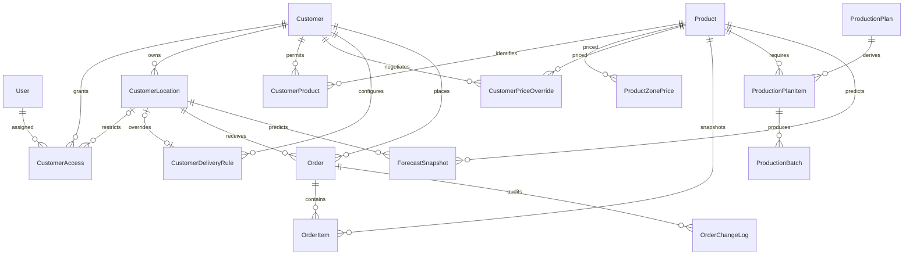

# Phase 1 analysis and architecture

Inspection date: October 3, 2026. Implemented scope: Phase 1/2 foundation.

Subsequent update: the supplied Nelson workbook has now been imported, and standard management flows use custom Bakery screens. See [the Nelson import report](nelson-import.md) for the 228 products, exact nine-price mapping, source identity handling, and review flags. This document's initial inspection describes the workspace before those business files were supplied.

## 1. Files and evidence

The initial workspace `C:\Users\tiram\Bakery` was empty, with no Git repository, AGENTS.md, existing code, spreadsheets, customer lists, product lists, paper order forms, or historical orders. The only supplied file was the attached application specification. Every named customer, product, quantity, price, and delivery example in it is illustrative, not an imported business record. No business records or demo accounts are seeded.

## 2. Existing fields

There are no observed source columns. The specification supplies the proposed fields below. Imports require explicit identifiers and never match customer names approximately or infer product mappings. Inspect real files and revise the import adapters before importing a source with different columns.

## 3. Proposed schema, implemented as the foundation

| Model | Principal fields and purpose |
| --- | --- |
| Django User | Individual password-based login; permissions through groups |
| Customer | Unique text code, name, zone 1–3, active, default lead days/cutoff/timezone/late policy, terms, notes |
| CustomerLocation | Customer, text location code/store number, name, address/city/state/ZIP/phone, active |
| CustomerAccess | User, customer, optional location, active; blank location grants all active locations within that account |
| Product | Unique text internal code, name, description, text UPC, category, pack size, unit, production lead, active, sort order |
| CustomerProduct | Customer/product, VendorID, customer SKU, display-name override, active, sort order |
| ProductZonePrice | Product/zone, Decimal price, effective/expiration dates, active |
| CustomerPriceOverride | Customer/product, Decimal override, effective/expiration dates, active, reason, notes, creator |
| CustomerDeliveryRule | Customer, optional unique location, delivery weekdays, optional notice/cutoff/timezone/late-policy overrides |
| Order | Business order number, customer/location, order/submission/delivery dates, optional summary production date, PO, status, late/approval flags, notes, totals, creator |
| OrderItem | Product/quantity, unit price/source/line total, VendorID/SKU/UPC/name/pack/unit snapshots, line-specific production date |
| OrderChangeLog | Order/product, old/new quantity, user, time, structured change details |
| ProductionPlan | Unique production date, workflow status |
| ProductionPlanItem | Plan/product, separately stored confirmed/forecast/planned/produced counts, last derivation time |
| ProductionBatch | Plan item, produced quantity, operator, notes, timestamps |
| ForecastSnapshot | Customer/location/product, delivery/production dates, forecast/confirmed counts, confidence, sample size, method, evidence, optional reconciled actual, timestamp |
| MasterDataChange | Append-only administration/import audit: model/key, before/after, actor or import source, timestamp |

Zone prices are normalized into dated rows rather than three mutable product columns. This supports scheduled changes and explicit history. Monetary values use Decimal. Business identifiers remain text, including UPCs and VendorIDs. Quantity is currently an integer in the product's ordering unit; no mixed-unit totals are presented as cases.

## 4. Exact relationships

Uniqueness constraints: customer code; product code; customer/location code; customer/product; product/zone/effective date; customer/product/override-effective date; account-wide delivery rule; location delivery rule; user/customer/location access; account-wide user/customer access; order number; order/product; production date; plan/product.

Foreign keys to financially relevant master data use PROTECT. Forms and imports validate customer/location consistency. Access queries also reject mismatched assignments defensively. Master-data admin supports deactivation rather than deletion. Order and production models are not exposed for manual admin entry; later phases must use their transactional services.

## 5. Pricing flow (implemented)

`resolve_price(customer, product, pricing_date)` checks active customer and active CustomerProduct/Product first. It resolves an active override covering the date (inclusive endpoints), then the assigned zone's active dated price, then returns `MISSING` with no price. Zero is a valid override. Expired/future/inactive prices do not apply. It never falls back to another zone.

The result contains price, source (`CUSTOMER_OVERRIDE`, `ZONE_1`, `ZONE_2`, `ZONE_3`, `MISSING`), standard price, override, and customer-facing description. `PricingBook` calculates an entire catalog with three database queries. Overlapping active periods are rejected by validated administration/imports; conflicting rows inserted outside those paths fail closed at resolution.

Phase 3 submission will calculate prices exclusively on the server and snapshot them into OrderItem in a transaction. Reorder copies product IDs and quantities into a draft, then resolves current prices. No submitted order is repriced from the product master.

## 6. Delivery and cutoff flow (implemented)

Location-specific delivery weekdays replace parent weekdays. Optional location notice/cutoff/timezone/late policy inherits from the account rule, then customer defaults. Missing calendars produce an explicit configuration error, not invented weekdays. Notice days are **calendar days**, minimum one. Delivery is a future date; same-day ordering is outside this foundation's policy.

The deadline is delivery date minus notice days, at the configured cutoff in its IANA timezone. At the exact deadline, an order is late. PROHIBIT removes expired dates; APPROVAL retains them with an approval flag; ALLOW retains them without approval. The service checks server time. Displayed cutoffs retain the rule's timezone, including DST.

Product production lead days calculate the line-specific production date separately. Customer notice and manufacturing offsets are different concepts. Phase 3 must validate that every selected product's production can still be scheduled and route exceptions to office approval; Phase 5 needs actual production calendars/holidays before treating these offsets as factory schedules.

## 7. Order and demand flow (designed; Phase 3–5)

Every customer request must obtain its account/location/order from the scoped access services, never a browser-provided customer selection alone. Ordering uses transactional draft updates and submission. Submitted browser prices are ignored. Unknown/restricted/inactive products and missing prices prevent partial submissions.

Readable `SO-000001` identifiers will use a dedicated sequence with transactional locking and a unique database constraint, rather than exposing PKs or using `MAX()+1`. Submission needs an idempotency token and locks to prevent duplicate orders. PostgreSQL is required to test concurrent row locking before production use.

Demand will be centralized and derived from eligible OrderItem rows, grouped by product, category, customer, location, delivery date, or line production date. Drafts, cancelled orders, and approval-pending submissions contribute zero confirmed demand. Accepted submitted orders and subsequent fulfilment states contribute until cancellation. Management can drill down to the underlying orders. The definition of "confirmed" must be agreed before Phase 4; the initial design counts accepted submissions even if office review status has not advanced to CONFIRMED.

ProductionPlanItem is a dated planning projection, not another place to enter customer demand. Refresh it from orders plus missing-demand forecast under a transaction, preserving planned targets and produced batch history. Quantities must be expressed in a consistent product-specific unit. All later picking, delivery, and invoicing reference the original order.

## 8. MVP forecast methodology (designed; Phase 6)

Forecast at **location + product + delivery date** granularity, summing locations for account totals. Start with the last four same-weekday calendar weeks, and use weights 4, 3, 2, 1 from newest to oldest. Aggregate multiple valid orders on one comparable date. Exclude cancelled/draft orders. An established eligible week with no order contributes zero; pre-account history is not assumed to be zero. Sparse history must report low confidence, not an invented estimate. If no comparable history exists, return no forecast.

Store dates, quantities, weights, sample size, model version, confidence, and creation time in ForecastSnapshot. The live missing-demand calculation excludes any location/date with an accepted actual order, even if it omitted the predicted product: an actual order replaces that expected order, not merely matching lines. Approval-pending late orders remain visible to office staff separately and do not silently count as accepted demand. The initial expected-order forecast expires at cutoff; a later late-order forecast would need its own visible policy.

Display confirmed, expected additional, and expected total separately. Forecasts are management-only and never submitted as customer orders. Snapshots remain immutable evidence when live contributions disappear, enabling later forecast-versus-actual reconciliation. Validate behavior with no history, cancelled history, sparse history, zero weeks, actual arrival, and cutoff expiration before enabling forecasts.

## 9. Customer UX

Implemented: secure sign-in/sign-out/password change, scoped accounts and store locations, searchable permitted product catalog, customer-specific current pricing, available delivery dates and approval labels.

Phase 3: next delivery/deadline; largest action is reorder usual/last order. Copy any prior order into a draft. Large +/− and numeric quantity controls naturally update it; zero removes a line. Search names, UPC, SKU, VendorID, internal code. Preserve supplied ordering/grouping. Review server totals and submit once. Reorders explicitly flag unavailable products. There are no nonfunctional order buttons in the foundation.

## 10. Bakery UX

Implemented: responsive warm neutral workspace, actual master-data counts, a setup checklist, recent audit changes, searchable customer/product/price lists, management links, atomic file uploads, header-only templates, and role-separated navigation. Checklist completion indicates presence of records, not account-by-account business readiness.

Phase 4–6: incoming orders and late approvals; focused exceptions; production today/tomorrow/3/7-day views; confirmed versus forecast totals; customer drilldowns; delivery-date demand grid; cutoff monitor; forecast explanation and reconciliation. Do not fabricate metrics in the absence of history.

## 11. Implementation sequence and verification

1. Phase 1: inspection, architecture, normalized models/migration, database and relation validation tests.
2. Phase 2: master data/admin, imports, authentication/password changes, explicit roles/access assignments, centralized pricing/delivery services, responsive setup/catalog screens, isolation/import/price/cutoff tests.
3. Phase 3: transactional customer draft/reorder/submission, readable identifiers/idempotency, immutable price snapshots, under-one-minute ordering usability checks.
4. Phase 4: office status/quantity changes, approval requests, audit events, printable orders, received/expected/cutoff views.
5. Phase 5: live demand service, product-specific production dates, drilldowns, derived plans and production batches.
6. Phase 6: deterministic forecast service, missing-demand exclusion, immutable evidence, accuracy reconciliation.
7. Phase 7: picking/packing/scanning/loading/drivers/delivery/invoices/accounting.

Run the relevant phase tests after each implementation. Do not represent future tables as working workflows. Indexes cover date/status/account/product demand paths. Lists paginate and use related-object joins. Forecast queries must be batched rather than one query per customer/product/day.

## 12. Unresolved business data and policies

- No authoritative customer or product identifiers, mappings, VendorIDs, SKUs, UPCs, pack units, prices, or price validity periods were supplied.
- No paper layout/grouping exists to preserve yet.
- No real delivery calendars, holiday/closure rules, production calendars, account timezones, or lead/cutoff/late policies are known.
- Confirm if notice days mean calendar or business days and whether same-day delivery is ever permitted.
- Decide whether integer cases are universal or fractional quantities/mixed units are needed.
- Define taxes, freight, discounts, payment terms, currency, minimum orders, and invoice integration before calculating final invoice totals. The foundation assumes USD display only and implements no taxes.
- Clarify office approval for order edits, the status at which demand counts as confirmed, and cancellation after production.
- Decide user assignments (account-wide versus store-only); create individual logins rather than sharing passwords.
- Historical orders are unavailable, so no usual-order suggestions or credible forecasts can be trained or verified yet.
- Import schemas are explicit adapters, not assumptions about undisclosed spreadsheets. Add mappings after inspecting actual files.

Framework references: [Django 5.2 Python support](https://docs.djangoproject.com/en/6.0/releases/5.2/) and [Django authentication and permissions](https://docs.djangoproject.com/en/5.2/topics/auth/default/).
